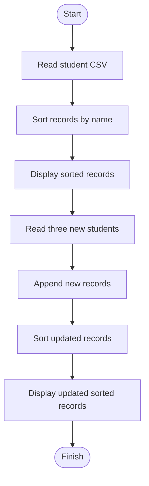
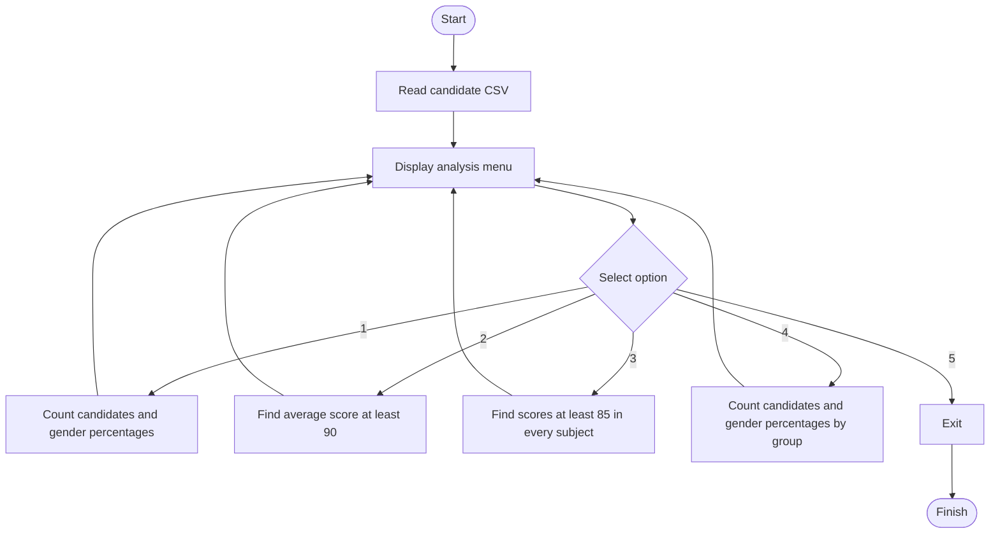

# Lab 04 Report

    Student Name: Song Vansak

    Lecturer Name: BOU Channa

    Major: Software Engineering (SE)

    Date: 15/11/2026

##

This report documents all seven Java exercises in Lab 04. The exercises focus on file handling, CSV data, student records, sorting, Java collections, streams, and generating summary files.

## Exercise 1 — Generate Lucky Numbers

### Explanation

The program creates `LuckyNumber.csv` and writes 500 lines to it. Each line contains a label from 1 to 500 and a randomly generated number from 0 to 99.

### Pseudocode

```text
START
    Open or create LuckyNumber.csv
    FOR i from 1 to 500
        Generate a random number from 0 to 99
        Write "Lucky Number i" and the random number
    END FOR
    Close the file
END
```

### Representative output

```text
LuckyNumber.csv created with 500 lucky-number records.
```

Source: [Exercise1.java](C:/School/PDI/src/Exercise1.java)

## Exercise 2 — Create Multiple Lucky-Number Files

### Explanation

The program asks for the number of files to create. It recreates the `Ex2LuckyNumber` directory, then generates the requested number of CSV files. Each file contains 100 random numbers from 1 to 100.

### Pseudocode

```text
START
    Read the number of files
    Recreate the Ex2LuckyNumber directory
    FOR each requested file
        Open filei.csv
        Write 100 random numbers from 1 to 100
        Close the file
    END FOR
END
```

### Representative output

```text
Enter number of files: 50
```

The program creates `file1.csv` through `file50.csv`, with 100 values in each file.

Source: [Exercise2.java](C:/School/PDI/src/Exercise2.java)

## Exercise 3 — Add Student Records

### Explanation

The program creates or opens `Ex3StudentData.csv` and adds three student records. If the file does not exist, it first writes the header containing the name, student ID, and gender columns.

### Pseudocode

```text
START
    Set the path to Ex3StudentData.csv
    REPEAT three times
        Read student name
        Read student ID
        Read student gender
        Append the student record to the CSV file
    END REPEAT
    Close input
END
```

### Representative output

```text
+ Student 1:
Enter Your Name: Alex
Enter Your ID: STU001
Enter Your Gender: Male
+ Student 2:
Enter Your Name: Dara
Enter Your ID: STU002
Enter Your Gender: Female
+ Student 3:
Enter Your Name: Lina
Enter Your ID: STU003
Enter Your Gender: Female
```

Source: [Exercise3.java](C:/School/PDI/src/Exercise3.java)

## Exercise 4 — Read and Display CSV Data

### Explanation

This program reads the contents of `Ex3StudentData.csv`, splits the data at commas, and displays each value in a tabular format.

### Pseudocode

```text
START
    Read all text from Ex3StudentData.csv
    Split the text using commas
    FOR each value
        Display the value in a formatted row
    END FOR
END
```

### Representative output

```text
Name            | Student ID       | Gender          |
Alex            | STU001            | Male            |
Dara            | STU002            | Female          |
Lina            | STU003            | Female          |
```

Source: [Exercise4.java](C:/School/PDI/src/Exercise4.java)

## Exercise 5 — Sort Students by Name

### Explanation

The program reads student records from `Ex3StudentData.csv` into a list, sorts the records by name using case-insensitive comparison, and writes the sorted records back to the file. It displays the current sorted data, accepts three additional students, sorts the updated data, and displays it again.

### Flowchart



### Pseudocode

```text
START
    Read all students except the header
    Sort students by name, ignoring case
    Write the sorted list back to the CSV file
    Display the sorted list
    Read and append three new students
    Sort and save the updated list
    Display the updated list
END
```

### Representative output

```text
Student Sort by Name
=================================================================
Name: Alex                 ID: STU001              Gender: Male
Name: Dara                 ID: STU002              Gender: Female
Name: Lina                 ID: STU003              Gender: Female
=================================================================
```

Source: [Exercise5.java](C:/School/PDI/src/Exercise5.java)

## Exercise 6 — Analyze Candidate Performance

### Explanation

The program reads candidate data from `CandidatePerformanceTest.csv` and provides a menu for analysis. It can count all candidates by gender, find candidates with an average score of at least 90%, find candidates who scored at least 85 in each subject, and summarize candidates by groups A to E.

### Flowchart



### Pseudocode

```text
START
    Read candidate records and skip the first three header lines
    REPEAT
        Display the menu
        Read an option
        IF option is 1
            Count all candidates and male/female percentages
        ELSE IF option is 2
            Filter candidates with average score at least 90
        ELSE IF option is 3
            Filter candidates with every subject score at least 85
        ELSE IF option is 4
            Count candidates and gender percentages in groups A to E
        ELSE IF option is 5
            Stop
        ELSE
            Display an invalid-option message
    END REPEAT
END
```

### Representative output

```text
1 - Total Candidates
2 - Candidate with score above 90%
3 - Each Subject with score at least 85%
4 - Candidate in each group
5 - Exit the program
Your Option: 1
Total Candidates: [calculated from CSV]
- Male: [calculated percentage] of total candidates
- Female: [calculated percentage] of total candidates
```

Source: [Exercise6.java](C:/School/PDI/src/Exercise6.java)

## Exercise 7 — Split Candidates into Group Files

### Explanation

The program reads candidate records from `CandidatePerformanceTest.csv`, creates the `Ex7GroupsOutput` directory, and writes each candidate to a CSV file based on group A through E. At the end of each group file, it appends the total number of candidates and the male and female percentages for that group.

### Pseudocode

```text
START
    Set the input CSV and output directory
    Create the output directory if it does not exist
    Read candidate records from the input file
    FOR each candidate
        Determine the candidate's group
        Write the candidate to the matching group CSV file
        Increase that group's total and gender count
    END FOR
    FOR each group from A to E
        Append total candidates
        Calculate and append male percentage
        Calculate and append female percentage
    END FOR
    Display that the group output was created
END
```

### Representative output

```text
> Ouput Groups/ is created!
```

The program creates group files such as `Group A.csv`, `Group B.csv`, `Group C.csv`, `Group D.csv`, and `Group E.csv`. Each file contains candidate records and a summary of totals and gender percentages.

Source: [Exercise7.java](C:/School/PDI/src/Exercise7.java)

## Conclusion

The seven exercises demonstrate practical Java file and data processing. They cover random data generation, directory and file creation, CSV reading and writing, object-like student records, sorting with collections, stream-based analysis, and exporting grouped summaries. The Lab 04 exercises build from basic file operations to complete candidate-data reporting workflows.
