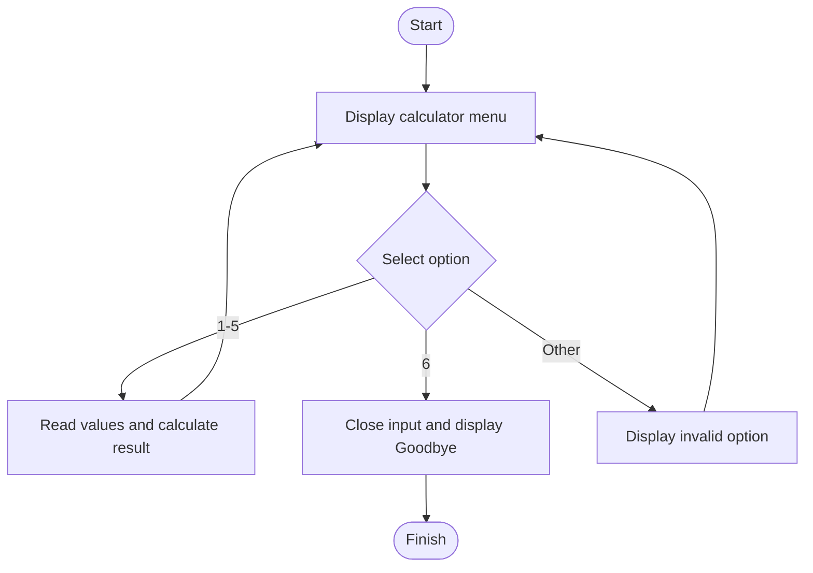

# Lab 05 Report

    Student Name: Song Vansak

    Lecturer Name: BOU Channa

    Major: Software Engineering (SE)

    Date: 15/11/2026

##

This report documents all eleven Java exercises in the Lab 05 project. The exercises demonstrate loops, selection, classes and objects, recursion, encapsulation, threads, file processing, lambda expressions, streams, and array operations.

## Exercise 1 — Running Sum of Even Numbers

### Explanation

The program loops through the even numbers from 2 to 100. Before adding the current even number to `sum`, it prints the current running total. The result is a sequence of running sums.

### Pseudocode

```text
START
    sum = 2
    FOR i from 2 to 100, increasing by 2
        Display sum
        sum = sum + i
    END FOR
END
```

### Representative output

```text
2
4
8
14
22
...
2452
```

Source: [Exercise1.java](C:/School/PDI/src/Exercise1.java)

## Exercise 2 — Menu-Driven Calculator

### Explanation

This program repeatedly displays a calculator menu. A `switch` statement performs addition, subtraction, multiplication, division, or the sum from 1 to `n`. The loop ends when the user selects option 6.

### Flowchart



### Pseudocode

```text
START
    REPEAT while running
        Display menu
        Read option
        IF option is 1, 2, 3, or 4
            Read two numbers and perform the selected operation
        ELSE IF option is 5
            Read n and calculate the sum from 1 to n
        ELSE IF option is 6
            Stop the loop
        ELSE
            Display invalid option
    END REPEAT
    Display Goodbye
END
```

### Representative output

```text
Calculator
1 - Sum
2 - Subtract
3 - Multiplication
4 - Division
5 - Sum from 1 to n
6 - Exit
Yout option: 5
Enter number n: 6
Sum from 1 to 6 is: 21
Goodbye!!
```

Source: [Exercise2.java](C:/School/PDI/src/Exercise2.java)

## Exercise 3 — Book Constructors

### Explanation

The program defines a nested `Book` class with two constructors. The parameterized constructor creates a book from a title, author, and price. The no-argument constructor creates a book with default values. The selected book is displayed with a method.

### Pseudocode

```text
START
    Display book options
    Read option
    IF option is 1
        Read title, author, and price
        Create a Book with those values
    ELSE IF option is 2
        Create an empty Book with default values
    END IF
    Display the book details
END
```

### Representative output

```text
1 - Add new book
2 - Add empty book
Your Option: 2
Here is your book:
Book details:
Title: unknown
Author: unknown
Price: 0.0
```

Source: [Exercise3.java](C:/School/PDI/src/Exercise3.java)

## Exercise 4 — Employee Encapsulation and Deposit

### Explanation

The program defines an `Employee` class with private fields and public getter methods. It reads employee information, creates an employee object, deposits an amount into the salary, and displays the updated salary.

### Pseudocode

```text
START
    Read employee name, age, ID, salary, and role
    Create an Employee object
    Read deposit amount
    Add the deposit to the salary
    Display updated salary
END
```

### Representative output

```text
Enter Name: Alex
Enter Age: 25
Enter ID: 1001
Enter Salary: 1000
Enter Role: Developer
Enter amount to Deposit: 250
1250.0
```

Source: [Exercise4.java](C:/School/PDI/src/Exercise4.java)

## Exercise 5 — Recursive Factorial

### Explanation

The `factorial` method calculates a factorial recursively. When `n` is 0 or 1, it returns 1. Otherwise, it multiplies `n` by the factorial of `n - 1`. The program calls the method with 15 and prints intermediate results while the recursion returns.

### Pseudocode

```text
FUNCTION factorial(n)
    IF n <= 1
        RETURN 1
    END IF
    result = n * factorial(n - 1)
    Display result
    RETURN result
END FUNCTION

START
    factorial(15)
END
```

### Representative output

```text
2
6
24
120
...
1307674368000
```

Source: [Exercise5.java](C:/School/PDI/src/Exercise5.java)

## Exercise 6 — Rectangle and Circle Geometry

### Explanation

The program defines `Rectangle` and `Circle` classes. Each class stores its dimensions and provides methods for area and perimeter. The main method creates one object of each type and displays the calculated values.

### Pseudocode

```text
START
    Create rectangle with width 10 and height 20
    Display rectangle perimeter and area
    Create circle with radius 5
    Display circle perimeter and area
END
```

### Representative output

```text
+ Rectangle:
Width: 10.0, Height: 20.0
Perimeter: 30.0
Area: 200.0

+ Circle:
Radius: 5.0
Perimeter: 31.41592653589793
Area: 25.0
```

Source: [Exercise6.java](C:/School/PDI/src/Exercise6.java)

## Exercise 7 — Threads, Prime Numbers, and CSV Students

### Explanation

The program reads a non-negative number and starts three threads. One thread calculates the sum from 1 to `n`, one finds prime numbers from 1 to 100, and one reads student records from `students.csv` into an `ArrayList`. The threads are joined before the program finishes.

### Pseudocode

```text
START
    Read n
    IF n is negative
        Display an error and stop
    END IF
    Create a sum thread
    Create a prime-number thread
    Create a student CSV-reading thread
    Start all three threads
    Wait for all threads to finish
END
```

### Representative output

```text
Enter n: 5
Primes from 1 to 100: 2 3 5 ... 97
Sum from 1 to 5 = 15
Students loaded into ArrayList: 4
Student{name='Maya Chen', id='STU1001', age=19, gender='Female'}
...
```

Source: [Exercise7.java](C:/School/PDI/src/Exercise7.java)

## Exercise 8 — Runnable Tasks

### Explanation

This exercise performs the same three concurrent tasks as Exercise 7: calculating a sum, finding primes, and loading students from CSV. The difference is that the tasks are first represented as `Runnable` lambda expressions and then passed to `Thread` objects.

### Pseudocode

```text
START
    Read n
    Define Runnable task for the sum
    Define Runnable task for prime numbers
    Define Runnable task for CSV students
    Create threads from the Runnable tasks
    Start all threads
    Join all threads
END
```

### Representative output

```text
Enter n: 5
Primes from 1 to 100: 2 3 5 ... 97
Sum from 1 to 5 = 15
Students loaded into ArrayList: 4
```

Source: [Exercise8.java](C:/School/PDI/src/Exercise8.java)

## Exercise 9 — Stream Transformations

### Explanation

The program processes a list of integers with streams. It maps each number to its cube, filters only positive numbers, and sorts the original values in ascending order.

### Pseudocode

```text
START
    Create a list of numbers
    Create cubes by mapping every number to number * number * number
    Create positiveNumbers by keeping values greater than zero
    Create sortedNumbers by sorting the list
    Display all three lists
END
```

### Representative output

```text
Cubes: [125, 8, 729, -1, 27, -512, 8000, -125000]
Positive numbers: [5, 2, 9, 3, 20]
Sorted numbers: [-50, -8, -1, 2, 3, 5, 9, 20]
```

Source: [Exercise9.java](C:/School/PDI/src/Exercise9.java)

## Exercise 10 — Alphabetical Student Names

### Explanation

The program reads the first column from `students.csv`, skips the header, stores non-empty names in an `ArrayList`, and sorts the names alphabetically without considering letter case.

### Pseudocode

```text
START
    Open students.csv
    Read each non-empty line
    Skip the header row
    Add each student name to a list
    Sort names using case-insensitive order
    Display names
END
```

### Representative output

```text
Student names in A-Z order:
Amara Patel
Daniel Sok
Leo Martin
Maya Chen
```

Source: [Exercise10.java](C:/School/PDI/src/Exercise10.java)

## Exercise 11 — Minimum and Maximum Array Values

### Explanation

The program creates an integer array, displays it with `Arrays.toString`, and uses `IntStream.min()` and `IntStream.max()` to find the smallest and largest values.

### Pseudocode

```text
START
    numbers = [5, 2, 9, 1, 3, 8]
    Display numbers
    minimum = smallest value in numbers
    maximum = largest value in numbers
    Display minimum and maximum
END
```

### Representative output

```text
Numbers: [5, 2, 9, 1, 3, 8]
Minimum: 1
Maximum: 9
```

Source: [Exercise11.java](C:/School/PDI/src/Exercise11.java)

## Conclusion

The eleven exercises demonstrate fundamental and intermediate Java programming techniques. Together they cover control flow, object-oriented programming, recursion, encapsulation, geometry calculations, multithreading, CSV file input, collections, lambda expressions, streams, and array processing. All eleven source files compiled successfully.
